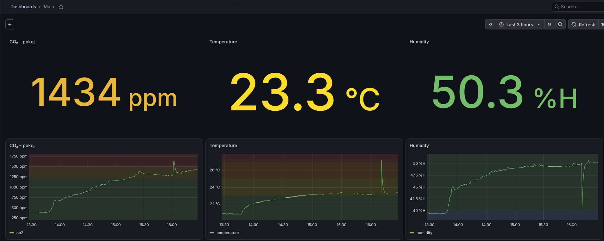
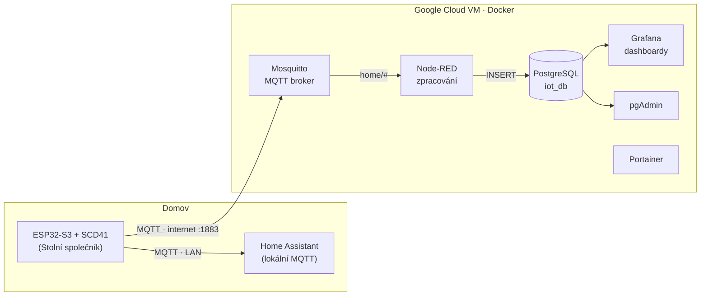

# IoT Stack – měření kvality vzduchu v cloudu

Kompletní IoT řetězec od senzoru po dashboard: ESP32 měří CO₂, teplotu a vlhkost,
posílá je přes MQTT do cloudu, Node-RED je zpracuje a uloží do PostgreSQL
a Grafana z nich kreslí živé dashboardy.



Celý serverový stack běží v Dockeru na jednom virtuálním serveru (Google Cloud,
Ubuntu 24.04 LTS) a spouští se jedním příkazem.

## Architektura



Zařízení má dvě nezávislá MQTT spojení: jedno do lokálního Home Assistantu
(ovládání, automatizace) a druhé do cloudu (dlouhodobé ukládání a analýza).
Spojení do cloudu navazuje vždy zařízení, takže doma není potřeba otevírat
žádné porty.

## Komponenty

| Služba     | K čemu                                  | Port   |
|------------|-----------------------------------------|--------|
| Mosquitto  | MQTT broker, příjem dat ze zařízení     | 1883   |
| Node-RED   | zpracování zpráv a zápis do DB          | 1880   |
| PostgreSQL | ukládání měření                         | – (jen interně) |
| Grafana    | dashboardy a vizualizace                | 3000   |
| pgAdmin    | webová správa databáze                  | 5050   |
| Portainer  | webová správa Docker kontejnerů         | 9443   |

## Datový kontrakt

**MQTT topicy**

| Topic                     | Směr      | Obsah |
|---------------------------|-----------|-------|
| `home/co2-sensor/state`   | zařízení → cloud | JSON s měřením, každých 30 s |
| `home/co2-sensor/status`  | zařízení → cloud | `online` / `offline` (LWT) |

**Payload**

```json
{"device":"co2-sensor","co2":650,"temperature":22.4,"humidity":48.1}
```

**Tabulka `sensor_data`** (viz [`db/init/01_schema.sql`](db/init/01_schema.sql))

| Sloupec       | Typ         | Popis |
|---------------|-------------|-------|
| `id`          | SERIAL      | primární klíč |
| `ts`          | TIMESTAMPTZ | čas příjmu (doplní DB, UTC) |
| `device`      | TEXT        | identifikátor zařízení |
| `temperature` | REAL        | °C |
| `humidity`    | REAL        | % RH |
| `co2`         | REAL        | ppm |

Čas doplňuje databáze při zápisu, protože zařízení nemá přesné hodiny.

## Instalace od nuly

### 1. Server

- VM s Ubuntu 24.04 LTS (stačí e2-small: 2 vCPU, 2 GB RAM, 20 GB disk)
- Ve firewallu povolené příchozí TCP porty: `22, 1880, 1883, 3000, 5050, 9443`
- Docker:

```bash
curl -fsSL https://get.docker.com | sudo sh
sudo usermod -aG docker $USER   # pak se odhlásit a znovu přihlásit
```

- Doporučený swap (při 2 GB RAM):

```bash
sudo fallocate -l 2G /swapfile && sudo chmod 600 /swapfile
sudo mkswap /swapfile && sudo swapon /swapfile
echo '/swapfile none swap sw 0 0' | sudo tee -a /etc/fstab
```

### 2. Repozitář a hesla

```bash
git clone https://github.com/<uzivatel>/iot-stack.git
cd iot-stack
cp .env.example .env
nano .env          # doplnit hesla (openssl rand -hex 12)
```

### 3. Uživatelé MQTT

```bash
docker run --rm -v ./mosquitto/config:/mosquitto/config eclipse-mosquitto:2 \
  mosquitto_passwd -c -b /mosquitto/config/passwd co2-sensor 'HESLO_ZARIZENI'
docker run --rm -v ./mosquitto/config:/mosquitto/config eclipse-mosquitto:2 \
  mosquitto_passwd -b /mosquitto/config/passwd nodered 'HESLO_NODERED'

sudo chown -R 1883:1883 mosquitto/config
sudo chmod 0700 mosquitto/config/passwd mosquitto/config/acl
```

### 4. Spuštění

```bash
docker compose up -d
docker compose ps
```

### 5. Konfigurace v aplikacích

- **Portainer** (`https://IP:9443`) – do 5 minut od startu vytvořit admin účet.
- **Node-RED** (`http://IP:1880`) – nainstalovat `node-red-contrib-postgresql`
  a importovat flow ze složky [`nodered/`](nodered/).
  Připojení: MQTT broker `mosquitto:1883` (uživatel `nodered`),
  databáze `postgres:5432 / iot_db` (uživatel `postgres`, SSL vypnuto).
- **Grafana** (`http://IP:3000`) – přidat data source PostgreSQL
  (`postgres:5432`, `iot_db`, SSL `disable`) a importovat dashboard
  ze složky [`grafana/dashboards/`](grafana/dashboards/).
- **pgAdmin** (`http://IP:5050`) – zaregistrovat server s hostem `postgres`.

## Užitečné příkazy

```bash
docker compose ps                     # stav služeb
docker compose logs -f mosquitto      # logy konkrétní služby
docker compose restart nodered        # restart služby
docker compose pull && docker compose up -d   # aktualizace image

# živé sledování MQTT zpráv
docker exec mosquitto mosquitto_sub -u nodered -P 'HESLO' -t 'home/#' -v

# záloha databáze
docker exec postgres pg_dump -U postgres iot_db > backup_$(date +%F).sql
```

## Bezpečnost

- Všechna hesla jsou v `.env` a `mosquitto/config/passwd`, oba soubory
  jsou v `.gitignore`.
- MQTT bez anonymního přístupu, každé zařízení má vlastního uživatele
  a ACL omezuje zápis jen do jeho topicu.
- PostgreSQL není publikovaný do internetu.

## Další rozvoj

- [ ] TLS pro MQTT (port 8883) – firmware je připravený
- [ ] Doména a HTTPS (Let's Encrypt) pro Grafanu
- [ ] Data z Aqara FP2 (přítomnost) přes Home Assistant `mqtt_statestream`
- [ ] TimescaleDB pro efektivní práci s časovými řadami
- [ ] Panel online/offline stavu zařízení

## Autor

Bc. Lukáš Jůza – ČZU v Praze, PEF, Informatika
